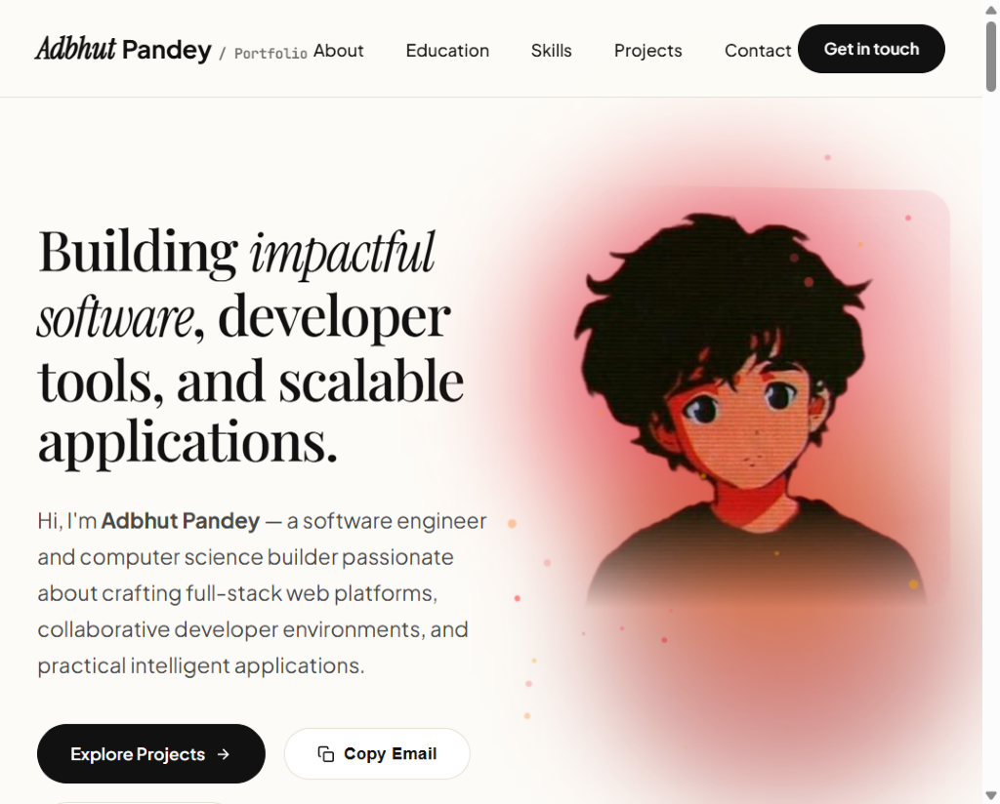

# Adbhut Pandey — Portfolio

Personal portfolio and software engineering showcase.

🌐 **Live Site:** [https://adbhut1234.github.io/Portfolio/](https://adbhut1234.github.io/Portfolio/)

## Tech Stack

- **Frontend:** HTML5, CSS3, Vanilla JavaScript (ES6+)
- **Integration:** GitHub REST API
- **Graphics:** CSS 3D Transforms, HTML5 Canvas

## Features

- **Interactive 3D Stage:** Cursor-following perspective tilt with ambient glow and particles.
- **GitHub Sync:** Automatically loads latest repositories from [@Adbhut1234](https://github.com/Adbhut1234).
- **Smooth Performance:** Lightweight, zero-dependency build running at 60–120 FPS.

## Contact

- **Email:** [adbhutpandey93@gmail.com](mailto:adbhutpandey93@gmail.com)
- **GitHub:** [@Adbhut1234](https://github.com/Adbhut1234)
